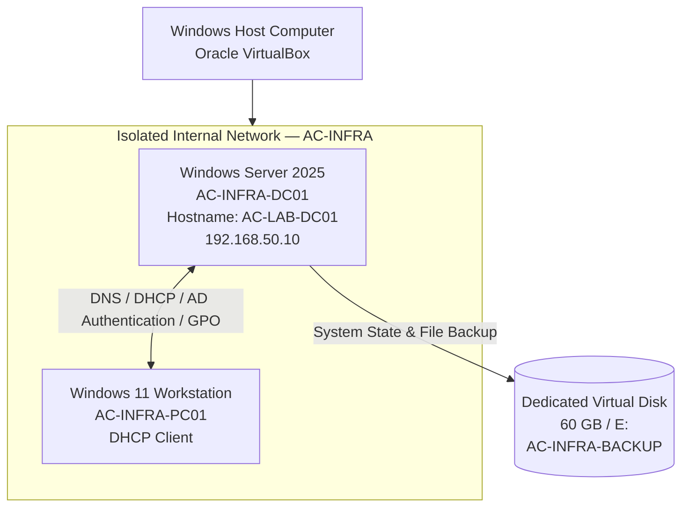
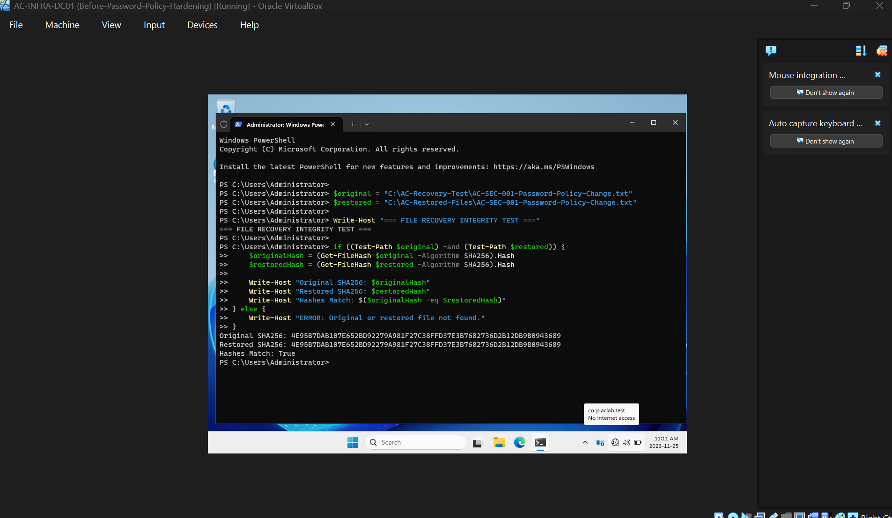

<div align="center">

# AC-IT Infrastructure & Reliability Lab

### Enterprise Windows Infrastructure | Security Hardening | Backup & Disaster Recovery

**Windows Server 2025 · Active Directory · DNS · DHCP · Group Policy · PowerShell · Oracle VirtualBox**

A hands-on enterprise infrastructure lab focused on maintaining secure, reliable, and recoverable Windows environments.

**Project Type:** Independent Technical Lab  
**Environment:** Isolated Virtual Enterprise Network  
**Status:** Core Implementation & Validation Complete  
**Completed:** November 2026

---

</div>

## 01 | Executive Summary

This project simulates the administration and operational maintenance of a small enterprise Windows infrastructure.

Using Windows Server 2025, Windows 11, and Oracle VirtualBox, I built upon an Active Directory environment to perform infrastructure health assessments, troubleshoot network services, implement security controls, and validate backup and recovery procedures.

The primary goal was to move beyond theoretical IT concepts and demonstrate practical skills in maintaining business-critical infrastructure.

### Key Outcomes

| Area | Verified Outcome |
|---|---|
| Active Directory | Domain controller health tests passed |
| Network Services | DNS, DHCP, and domain connectivity validated |
| Security | Domain password policy hardened |
| Group Policy | Workstation auto-lock policy verified |
| Backup | System State and file-level backups completed |
| Disaster Recovery | Test file successfully recovered |
| Data Integrity | Original and restored SHA-256 hashes matched |
| System Health | Five critical infrastructure services running |
| Patch Assessment | Installed updates reviewed; external access limitation documented |

> **Project highlight:** Successfully recovered a file from Windows Server Backup to an alternate location and verified its integrity using SHA-256 hashing, with zero reported recovery failures.

---

## 02 | Infrastructure Architecture

### Logical Network Topology



### Environment Configuration

| Component | Implementation |
|---|---|
| Virtualization Platform | Oracle VirtualBox |
| Server Operating System | Windows Server 2025 Standard Evaluation |
| Workstation Operating System | Windows 11 |
| Active Directory Domain | `corp.aclab.test` |
| Domain Controller | `AC-LAB-DC01` |
| Server VM | `AC-INFRA-DC01` |
| Client VM | `AC-INFRA-PC01` |
| Domain Controller Address | `192.168.50.10` |
| Network Configuration | Isolated VirtualBox internal network |
| Backup Destination | `E:\` |
| Backup Disk | 60 GB virtual disk |
| Automation / Administration | Windows PowerShell |

**Design rationale:** An isolated virtual network was used to practice enterprise infrastructure administration while minimizing exposure to external networks.

---

## 03 | Project Scope & Responsibilities

The lab covers six core infrastructure workstreams.

| Workstream | Responsibilities |
|---|---|
| Identity & Access | Active Directory verification and privileged account review |
| Networking | DNS, DHCP, domain discovery, and connectivity troubleshooting |
| Endpoint Security | Password policies, Group Policy, and workstation controls |
| System Reliability | Service health, event review, and Windows patch assessment |
| Backup Operations | Backup storage provisioning and backup version verification |
| Disaster Recovery | Alternate-location file restore and integrity verification |

---

## 04 | Implementation & Technical Validation

### 4.1 Active Directory & Domain Controller Health

Validated the existing Active Directory environment using native Windows administration tools.

**Technical checks performed:**

- Identified domain controller and Active Directory domain information.
- Verified domain controller discovery from the Windows 11 workstation.
- Checked domain secure-channel health.
- Executed domain controller diagnostic tests.
- Reviewed privileged Active Directory group membership.

**Selected commands:**

```powershell
Get-ADDomain
Get-ADDomainController

dcdiag /test:Advertising /test:Services

nltest /dsgetdc:corp.aclab.test

Test-ComputerSecureChannel -Verbose
```

**Verified outcome:** Connectivity, Advertising, and Services diagnostics passed. The Windows 11 workstation's domain secure channel was confirmed healthy.

---

### 4.2 DNS, DHCP & Network Troubleshooting

Investigated network configuration and service dependencies across the server and workstation.

**Activities included:**

- Verifying DNS resolution and service discovery records.
- Testing communication with the domain controller.
- Checking DHCP server authorization.
- Reviewing DHCP scope configuration and available addresses.
- Validating DHCP lease acquisition on the Windows 11 workstation.

**Selected commands:**

```powershell
ipconfig /all

Resolve-DnsName AC-LAB-DC01.corp.aclab.test

Test-NetConnection 192.168.50.10 -Port 53

Get-DhcpServerInDC

Get-DhcpServerv4Scope

Get-DhcpServerv4ScopeStatistics
```

**Verified outcome:** The workstation acquired an address from the configured DHCP scope, and network connectivity to the domain controller was established.

---

### 4.3 Security Hardening & Access Controls

Reviewed privileged accounts and strengthened the domain's default password policy.

#### Password Policy Configuration

| Security Control | Configured Value |
|---|---|
| Minimum Password Length | 14 characters |
| Password History | 12 passwords |
| Password Complexity | Enabled |
| Minimum Password Age | 1 day |
| Account Lockout Threshold | 10 attempts |
| Lockout Duration | 15 minutes |
| Lockout Observation Window | 15 minutes |

**Verification:**

```powershell
Get-ADDefaultDomainPasswordPolicy |
Select-Object MinPasswordLength,
PasswordHistoryCount,
ComplexityEnabled,
LockoutThreshold,
LockoutDuration
```

Reviewed membership of the Domain Admins group and inspected the built-in Administrator account configuration.

**Verified outcome:** Updated password policy settings were successfully applied and retrieved for validation.

**Scope note:** Configuration verification was completed; full authentication and lockout behavior testing was not performed.

---

### 4.4 Group Policy & Workstation Management

Validated the application of domain Group Policy on the Windows 11 workstation.

**Activities:**

- Confirmed domain computer policy processing.
- Verified the applied workstation auto-lock Group Policy.
- Checked the configured inactivity timeout.
- Reviewed results from an elevated PowerShell session.

**Selected commands:**

```powershell
gpresult /r /scope computer

Get-ItemProperty `
-Path "HKLM:\SOFTWARE\Microsoft\Windows\CurrentVersion\Policies\System" `
-Name InactivityTimeoutSecs
```

**Verified outcome:** The `GPO-Workstation_AutoLock` policy appeared in the applied Group Policy results, with an inactivity timeout of 600 seconds.

---

## 05 | Backup & Disaster Recovery

### 5.1 Backup Storage Provisioning

Provisioned an additional 60 GB virtual hard disk and configured it as a dedicated NTFS backup volume.

| Property | Configuration |
|---|---|
| Drive Letter | `E:` |
| Volume Label | `AC-INFRA-BACKUP` |
| File System | NTFS |
| Capacity | Approximately 60 GB |
| Backup Tool | Windows Server Backup |

### 5.2 System State Backup

Installed the Windows Server Backup feature and performed a System State backup of the domain controller.

**Backup verification:**

```powershell
wbadmin get versions -backupTarget:E:

wbadmin get items `
-version:11/25/2026-17:25 `
-backupTarget:E:
```

**Result:** Backup completed successfully and the catalog listed System State and related recoverable components.

**Recovery point:** `11/25/2026-17:25`

### 5.3 Controlled File-Level Backup

Prepared a noncritical test document in a dedicated recovery-testing directory.

**Source file:**

`C:\AC-Recovery-Test\AC-SEC-001-Password-Policy-Change.txt`

Created a separate backup using Windows Server Backup and verified its presence in the recovery catalog.

**File backup recovery point:** `11/25/2026-19:02`

### 5.4 File Restoration

Recovered the test document to an alternate directory to avoid overwriting the source file.

**Recovery destination:**

`C:\AC-Restored-Files`

**Verified results:**

| Recovery Metric | Result |
|---|---|
| Files Recovered | 1 |
| Data Restored | 974 bytes |
| Failed Files | 0 |
| Recovery Operation | Successful |
| Original File | Preserved |

### 5.5 SHA-256 Integrity Validation

Calculated SHA-256 hashes for the original and recovered files using PowerShell.

```powershell
$original = "C:\AC-Recovery-Test\AC-SEC-001-Password-Policy-Change.txt"

$restored = "C:\AC-Restored-Files\AC-SEC-001-Password-Policy-Change.txt"

(Get-FileHash $original -Algorithm SHA256).Hash

(Get-FileHash $restored -Algorithm SHA256).Hash
```

**Validation result:**

```text
Original and Restored SHA-256: IDENTICAL
Hashes Match: True
Recovery Integrity: PASS
```

This demonstrates that the restored file was identical in content to the original test file.

> **Recovery scope:** File-level restoration was tested successfully. A full Active Directory or domain controller recovery was not attempted, avoiding unnecessary risk to the functioning lab environment.

---

## 06 | Infrastructure Monitoring & Health Audit

Performed final checks to confirm that critical infrastructure services remained operational following configuration changes, backup, and recovery testing.

### Critical Services

| Service | State | Startup Type |
|---|---|---|
| Active Directory Domain Services | Running | Automatic |
| DNS Server | Running | Automatic |
| DHCP Server | Running | Automatic |
| Netlogon | Running | Automatic |
| Windows Time | Running | Automatic |

**Verification command:**

```powershell
Get-Service NTDS,DNS,DHCPServer,Netlogon,W32Time |
Format-Table Name,Status,StartType -AutoSize
```

### Domain Controller Diagnostics

| Test | Result |
|---|---|
| Connectivity | PASS |
| Advertising | PASS |
| Services | PASS |

The selected Active Directory diagnostic tests completed successfully.

---

## 07 | Windows Update & Patch Assessment

Reviewed installed updates and system configuration using native Windows Server tools.

**Operating System:** Windows Server 2025 Standard Evaluation  
**OS Build:** 26100

### Assessment Findings

- Recorded installed Windows security updates.
- Inspected Windows Update service configuration.
- Checked common registry indicators for a pending reboot.
- Verified that both checked reboot indicators were absent.
- Tested external DNS and HTTPS connectivity to Windows Update infrastructure.

**Observed limitation:** The domain controller was connected to an isolated VirtualBox internal network without an external gateway. External Windows Update DNS resolution and HTTPS connectivity were unsuccessful.

**Assessment:** Windows patch compliance remains unverified because an online update scan was not completed.

This limitation is documented as an environment constraint rather than a successful patch-compliance result.

---

## 08 | Evidence & Screenshots

The `Screenshots/` folder contains numbered technical evidence documenting configuration, troubleshooting, validation, and recovery activities.

### Selected Evidence

| Evidence | Screenshot |
|---|---|
| System State Backup Completion | [View](Screenshots/49-system-state-backup-completed.png) |
| Backup Version Verification | [View](Screenshots/50-system-state-backup-version-verification.png) |
| Backup Storage Verification | [View](Screenshots/51-backup-storage-integrity-check.png) |
| Recoverable Components | [View](Screenshots/52-backup-recoverable-items-review.png) |
| File Recovery Completion | [View](Screenshots/60-file-recovery-completed.png) |
| SHA-256 Integrity Verification | [View](Screenshots/61-file-recovery-integrity-verified.png) |
| Domain Controller Health | [View](Screenshots/62-final-infrastructure-health-check.png) |
| Critical Services Audit | [View](Screenshots/63-final-critical-services-audit.png) |
| Windows Patch Review | [View](Screenshots/64-windows-server-patch-audit.png) |
| Windows Update Connectivity | [View](Screenshots/66-windows-update-connectivity-check.png) |

### Recovery Evidence — Visual Preview

**Successful file restoration**


**SHA-256 integrity verification**



---

## 09 | Challenges & Lessons Learned

### Virtual Disk Provisioning

Configured a separate virtual disk as an NTFS backup destination and verified the volume was accessible to Windows Server Backup.

### Backup Operation & Validation

Managed backup discovery, monitored system writers, reviewed backup status, and verified recovery points using `wbadmin`.

### Recovery Integrity

Demonstrated that completing a backup is only one part of data protection. A successful recovery operation and integrity verification provide stronger evidence of recoverability.

### Isolated Network Limitations

Identified the relationship between internal networking, DNS resolution, default gateways, and external update availability.

### Operational Documentation

Captured numbered screenshots and recorded command outputs to create an auditable technical record of the laboratory work.

---

## 10 | Technical Skills Demonstrated

**Infrastructure:** Windows Server 2025, Active Directory Domain Services, DNS, DHCP, Group Policy

**Administration:** PowerShell, Windows Server Backup, VirtualBox, Windows 11

**Security:** Privileged Account Review, Password Policy Hardening, Endpoint Security Controls

**Reliability:** Infrastructure Diagnostics, Event Log Review, Backup Validation, File Recovery, SHA-256 Integrity Testing

**IT Support:** Root-Cause Investigation, Troubleshooting, Technical Documentation, Verification Procedures

---

## 11 | Future Improvements

Potential extensions to the laboratory include:

- Testing domain controller disaster recovery using an isolated clone.
- Configuring scheduled backup jobs and retention monitoring.
- Implementing centralized event collection and alerting.
- Evaluating a controlled patch-management workflow.
- Expanding infrastructure health reporting through PowerShell automation.

These enhancements are not claimed as completed work.

---

## Project Disclaimer

This repository documents an independent hands-on learning environment built using evaluation software and virtual machines.

All systems, network addresses, and configurations belong to a simulated laboratory.

The project is intended to demonstrate practical technical skills and does not represent production deployment, formal security certification, or a fully tested enterprise disaster-recovery solution.

---

<div align="center">

**Designed, implemented, tested, and documented by Ashish Chauhan**

*IT Support | Windows Infrastructure | System Reliability*

[LinkedIn](https://www.linkedin.com/in/ashish-chauhan-b518252a6/)

</div>
