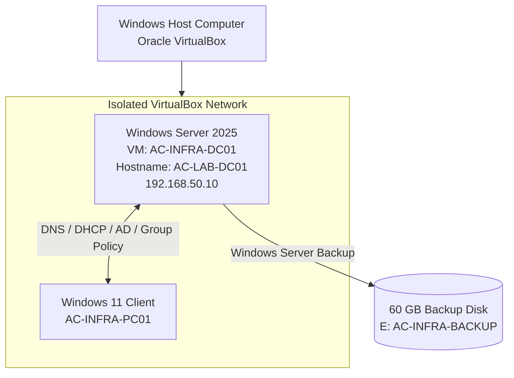
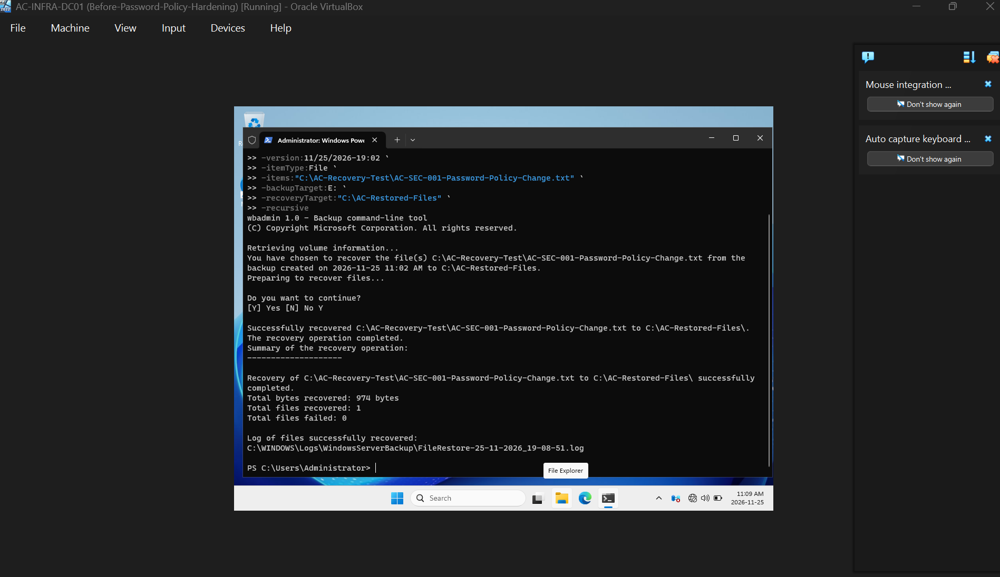

<div align="center">

# AC-IT Infrastructure & Reliability Lab

### Windows Server Administration | Active Directory | Security | Backup & Recovery

**Windows Server 2025 · Windows 11 · Active Directory · DNS · DHCP · Group Policy · PowerShell · VirtualBox**

A hands-on Windows infrastructure project focused on troubleshooting, system reliability, security configuration, and recovery testing.

**Project Type:** Independent Home Lab  
**Environment:** Isolated Virtual Network  
**Status:** Core Technical Lab Completed  
**Completed:** November 2026

---

</div>

## About This Project

I built this project to gain practical experience with the kinds of infrastructure issues that IT Support Technicians and Systems Administrators encounter.

I used an existing Windows Server and Active Directory lab as the starting point, then created isolated virtual machine copies to investigate domain connectivity, check essential Windows services, review security settings, and perform backup and recovery testing.

I followed technical guidance and used PowerShell throughout the project, but I also worked through actual configuration checks, investigated unexpected results, and verified whether the changes worked.

My main goal was to understand not just which commands to run, but why they are useful and how to interpret the results.

### What I Accomplished

| Area | Result |
|---|---|
| Active Directory | Verified domain controller health and connectivity |
| DNS & DHCP | Investigated network services and client addressing |
| Group Policy | Verified workstation policy application |
| Security | Strengthened the domain password policy |
| Backup | Completed Windows Server System State and file backups |
| Recovery | Successfully restored a test file |
| Integrity | Confirmed matching SHA-256 file hashes |
| Monitoring | Verified critical Windows infrastructure services |
| Patch Assessment | Investigated Windows Update connectivity limitations |

**Main achievement:** Successfully restored a backed-up file to a separate directory and confirmed that the recovered data was identical to the original using SHA-256 hashing.

---

## 01 | Lab Architecture

### Network Topology



### Environment Details

| Component | Configuration |
|---|---|
| Virtualization | Oracle VirtualBox |
| Server OS | Windows Server 2025 Standard Evaluation |
| Client OS | Windows 11 |
| Active Directory Domain | `corp.aclab.test` |
| Domain Controller Hostname | `AC-LAB-DC01` |
| Server VM Name | `AC-INFRA-DC01` |
| Client VM Name | `AC-INFRA-PC01` |
| Server IP Address | `192.168.50.10` |
| Network | Isolated VirtualBox network |
| Backup Disk | 60 GB virtual disk |
| Backup Destination | `E:\` |
| Administration Tools | PowerShell, DCDIAG, Windows Server Backup |

### Why I Used an Isolated Network

I wanted to experiment with Active Directory, DHCP, DNS, and security settings without affecting my main laptop or other devices.

I used separate virtual machines so I could test infrastructure configurations and troubleshoot issues in a controlled environment.

The isolated setup also introduced limitations, particularly when checking external services such as Windows Update.

---

## 02 | Active Directory & Domain Health

One of my first priorities was checking whether the cloned domain controller and Windows client were communicating correctly.

I verified the domain information, domain controller discovery, and the client computer's connection to Active Directory.

### Tools and Commands

```powershell
Get-ADDomain
Get-ADDomainController

dcdiag /test:Advertising /test:Services

nltest /dsgetdc:corp.aclab.test

Test-ComputerSecureChannel -Verbose
```

### What I Checked

- Active Directory domain information
- Domain controller discovery
- DNS-related domain connectivity
- Workstation secure-channel status
- Domain controller service health

### Result

The selected DCDIAG tests for Connectivity, Advertising, and Services passed.

The workstation's domain secure channel was also verified.

### What I Learned

A computer being connected to a network does not automatically mean it can communicate correctly with Active Directory.

DNS configuration, domain controller discovery, authentication, and network connectivity all need to work together.

**Evidence:**

[Domain controller health verification](Screenshots/62-final-infrastructure-health-check.png)

---

## 03 | Troubleshooting Case Study: DHCP & Network Connectivity

### The Situation

During the network validation stage, I investigated DHCP address assignment and connectivity between the Windows 11 client and the domain controller.

The lab included checks for DHCP service availability, address allocation, and client-to-server communication.

### My Troubleshooting Process

I used PowerShell to review network configuration and validate how the Windows client was communicating with the server.

```powershell
ipconfig /all

Get-DhcpServerInDC

Get-DhcpServerv4Scope

Get-DhcpServerv4ScopeStatistics

Test-NetConnection 192.168.50.10 -Port 53
```

I reviewed:

1. Whether the DHCP service was available.
2. Whether the DHCP scope was configured.
3. Whether the client received an appropriate IP address.
4. Whether the client could communicate with the server.
5. Whether DNS resolution was working.

### Result

I verified DHCP address assignment and established client-to-server connectivity in the lab.

### What I Learned

When a workstation has a network issue, I should not immediately assume the problem is with the server.

I need to inspect the client's IP configuration, DHCP availability, DNS settings, and the underlying network connection.

This helped me understand how to approach network troubleshooting in a more systematic way.

### Evidence

[DHCP investigation](Screenshots/13-dhcp-incident-investigation.png)

[Client IP address assignment](Screenshots/18-client-dhcp-address-assignment.png)

[Client-server connectivity test](Screenshots/20-client-server-connectivity-validation.png)

---

## 04 | Security Hardening & Access Management

After checking the infrastructure, I reviewed security settings on the domain controller.

This included privileged account membership and the domain's password and account lockout policies.

### Password Policy Changes

| Security Setting | Configured Value |
|---|---|
| Minimum Password Length | 14 characters |
| Password History | 12 passwords |
| Password Complexity | Enabled |
| Minimum Password Age | 1 day |
| Account Lockout Threshold | 10 failed attempts |
| Lockout Duration | 15 minutes |
| Lockout Observation Window | 15 minutes |

### Policy Verification

```powershell
Get-ADDefaultDomainPasswordPolicy |
Select-Object MinPasswordLength,
PasswordHistoryCount,
ComplexityEnabled,
MinPasswordAge,
LockoutThreshold,
LockoutDuration,
LockoutObservationWindow
```

### My Approach

Before changing the password policy, I reviewed the existing configuration and created a VirtualBox snapshot.

After applying the new settings, I ran verification commands to confirm the updated configuration.

I also documented the change in a local security change record.

### Result

The updated password policy values were verified successfully.

**Limitation:** I verified the policy configuration, but did not perform a complete test of every password rejection and account lockout scenario.

### What I Learned

Security changes should be documented and verified rather than assumed to be successful.

I also learned why administrators should establish a recovery point before making significant infrastructure changes.

### Evidence

[Password policy verification](Screenshots/34-password-policy-hardening-verification.png)

[Security change record](Screenshots/36-security-change-record.png)

---

## 05 | Group Policy & Workstation Security

I reviewed the Group Policies applied to the Windows 11 workstation.

One of the checks involved confirming a workstation inactivity timeout of 600 seconds.

### Commands Used

```powershell
gpresult /r /scope computer

Get-ItemProperty `
-Path "HKLM:\SOFTWARE\Microsoft\Windows\CurrentVersion\Policies\System" `
-Name InactivityTimeoutSecs
```

### Result

The workstation auto-lock policy appeared in the applied Group Policy results.

The configured inactivity timeout was 600 seconds.

### What I Learned

A configured Group Policy and an applied Group Policy are not necessarily the same thing.

Using `gpresult` and checking relevant Windows settings helped me verify the effective workstation configuration.

**Evidence:**

[Workstation auto-lock policy](Screenshots/27-workstation-auto-lock-policy.png)

---

## 06 | Backup & Recovery Implementation

This was one of the most important parts of the project for me.

I wanted to learn how to create a backup, identify available recovery points, recover a file, and verify that the restored data was correct.

### 6.1 Dedicated Backup Storage

I added a separate 60 GB virtual disk to the Windows Server VM.

I initialized the disk, configured an NTFS volume, and assigned it the drive letter `E:`.

| Property | Value |
|---|---|
| Capacity | 60 GB |
| Drive Letter | `E:` |
| Label | `AC-INFRA-BACKUP` |
| File System | NTFS |
| Backup Tool | Windows Server Backup |

**Evidence:**

[Backup volume configuration](Screenshots/45-backup-volume-verification.png)

### 6.2 System State Backup

I installed the Windows Server Backup feature and completed a System State backup.

I then checked the backup catalog to verify that a recovery point existed.

```powershell
wbadmin get versions -backupTarget:E:

wbadmin get items `
-version:11/25/2026-17:25 `
-backupTarget:E:
```

**Result:** The System State backup completed successfully, and recoverable components were listed.

**Recovery point:** `11/25/2026-17:25`

### Evidence

[Successful System State backup](Screenshots/49-system-state-backup-completed.png)

[Backup version verification](Screenshots/50-system-state-backup-version-verification.png)

---

## 07 | Troubleshooting Case Study: File Backup & Recovery

### The Objective

Creating a backup does not prove that the data can be recovered.

I wanted to test an actual restoration process without overwriting important system files.

### My Approach

I prepared a small test document:

```text
C:\AC-Recovery-Test\
AC-SEC-001-Password-Policy-Change.txt
```

I created a separate file-level backup using Windows Server Backup.

After verifying the backup recovery point, I restored the file to another location.

### Recovery Destination

```text
C:\AC-Restored-Files\
```

### Recovery Results

| Metric | Verified Result |
|---|---|
| Files Restored | 1 |
| Data Restored | 974 bytes |
| Failed Files | 0 |
| Recovery Status | Successful |
| Original File | Preserved |

### Integrity Verification

I used SHA-256 hashing to compare the original and restored files.

```powershell
$original = "C:\AC-Recovery-Test\AC-SEC-001-Password-Policy-Change.txt"

$restored = "C:\AC-Restored-Files\AC-SEC-001-Password-Policy-Change.txt"

$originalHash = (Get-FileHash $original -Algorithm SHA256).Hash

$restoredHash = (Get-FileHash $restored -Algorithm SHA256).Hash

$originalHash -eq $restoredHash
```

### Result

```text
Files Restored: 1
Recovery Failures: 0
Hashes Match: True
```

The matching hashes confirmed that the recovered file had the same content as the original file.

### What I Learned

I learned why backup verification should include more than checking for a successful backup message.

Restoring data and confirming its integrity provide stronger evidence that a backup is useful.

I also learned why restoring a file to a separate directory is safer during recovery testing.

### Evidence

[File recovery completed](Screenshots/60-file-recovery-completed.png)

[SHA-256 integrity verified](Screenshots/61-file-recovery-integrity-verified.png)

### Recovery Test Scope

A file-level restoration was completed successfully.

The System State backup was created and verified in the backup catalog, but a full Active Directory or domain controller recovery was not performed.

---

## 08 | Final Infrastructure Health Verification

After the backup and recovery testing, I performed another health check to confirm that essential domain controller services remained operational.

### Services Checked

| Service | Status | Startup Type |
|---|---|---|
| Active Directory (NTDS) | Running | Automatic |
| DNS Server | Running | Automatic |
| DHCP Server | Running | Automatic |
| Netlogon | Running | Automatic |
| Windows Time | Running | Automatic |

### Verification

```powershell
Get-Service NTDS,DNS,DHCPServer,Netlogon,W32Time |
Format-Table Name,Status,StartType -AutoSize
```

I also ran selected DCDIAG tests.

| Test | Result |
|---|---|
| Connectivity | PASS |
| Advertising | PASS |
| Services | PASS |

These results confirmed that the selected critical services and diagnostic tests were healthy at the time of checking.

**Evidence:**

[Final critical services audit](Screenshots/63-final-critical-services-audit.png)

---

## 09 | Troubleshooting Case Study: Windows Update Connectivity

### The Problem

During the final maintenance audit, I reviewed the Windows Server update history and attempted to check connectivity to Microsoft's update infrastructure.

External DNS resolution for `download.windowsupdate.com` failed.

### Investigation

I checked the server's network configuration and attempted to test HTTPS connectivity.

```powershell
Get-NetIPConfiguration

Resolve-DnsName download.windowsupdate.com

Test-NetConnection download.windowsupdate.com -Port 443
```

### Findings

The server had the following network configuration:

```text
IPv4 Address: 192.168.50.10
Default Gateway: Not Configured
External DNS Resolution: Failed
HTTPS Connectivity: Failed
```

### My Decision

I kept the server on its isolated VirtualBox network rather than changing the network configuration simply to reach Windows Update.

I documented that a complete online patch assessment could not be performed.

### What I Learned

A DNS resolution failure does not always mean that the DNS service is broken.

The issue may involve network isolation, missing routes, or a default gateway.

This investigation helped me connect basic networking concepts with real troubleshooting.

### Evidence

[Windows Update connectivity investigation](Screenshots/66-windows-update-connectivity-check.png)

**Limitation:** Patch compliance remains unverified. No online Windows Update scan was completed.

---

## 10 | Featured Project Evidence

I captured 67 screenshots throughout the project to document the steps I performed and their results.

Rather than presenting every screenshot individually in the README, I selected the most useful evidence below.

| Area | Evidence |
|---|---|
| DHCP Troubleshooting | [Investigation](Screenshots/13-dhcp-incident-investigation.png) |
| Client Connectivity | [Connectivity Test](Screenshots/20-client-server-connectivity-validation.png) |
| Group Policy | [Workstation Auto-Lock](Screenshots/27-workstation-auto-lock-policy.png) |
| Password Hardening | [Policy Verification](Screenshots/34-password-policy-hardening-verification.png) |
| Backup Preparation | [Backup Volume](Screenshots/45-backup-volume-verification.png) |
| System State Backup | [Completed Backup](Screenshots/49-system-state-backup-completed.png) |
| Recovery | [Successful Restoration](Screenshots/60-file-recovery-completed.png) |
| Integrity Verification | [SHA-256 Hash Match](Screenshots/61-file-recovery-integrity-verified.png) |
| Infrastructure Health | [Critical Services](Screenshots/63-final-critical-services-audit.png) |
| Network Limitation | [Windows Update Investigation](Screenshots/66-windows-update-connectivity-check.png) |

### Recovery Test — Visual Evidence

**Successful file restoration**



**SHA-256 integrity verification**


All additional evidence is available in the [Screenshots directory](Screenshots/).

---

## 11 | Key Lessons Learned

This project helped me better understand how different parts of a Windows infrastructure depend on each other.

My biggest takeaways were:

**Troubleshooting requires a process.** Checking IP settings, DNS, DHCP, and connectivity in a logical order is more useful than changing settings without knowing the cause.

**Verification matters.** I learned to confirm security changes, Group Policy application, backup completion, and recovery results instead of assuming they worked.

**Backups should be tested.** A backup job reporting success is only one part of a recovery plan. Restoring data and verifying its integrity provides stronger evidence.

**Network design affects troubleshooting.** My Windows Update investigation showed how an isolated network can prevent external services from being reached even when internal services are operating normally.

**Documentation is part of IT work.** Recording commands, results, configuration changes, and recovery procedures makes troubleshooting easier to explain and repeat.

---

## 12 | Technical Skills Demonstrated

| Category | Skills |
|---|---|
| Windows Infrastructure | Windows Server 2025, Active Directory, DNS, DHCP |
| Endpoint Administration | Windows 11, Group Policy, Workstation Security |
| PowerShell | System Diagnostics, Service Checks, Configuration Verification |
| Identity & Security | Privileged Account Review, Password Policy Hardening |
| Backup & Recovery | Windows Server Backup, System State Backup, File Recovery |
| Reliability | Domain Controller Diagnostics, Service Monitoring, Recovery Testing |
| Troubleshooting | Network Investigation, Root-Cause Analysis, Technical Documentation |
| Virtualization | Oracle VirtualBox, VM Cloning, Snapshots, Virtual Storage |

---

## 13 | Future Improvements

This project provided a foundation for further infrastructure work.

My next areas for improvement include:

- Testing Active Directory recovery in a separate, controlled environment.
- Automating routine infrastructure health checks using PowerShell.
- Configuring scheduled backup jobs and monitoring.
- Building a centralized event-monitoring solution.
- Exploring patch management in an appropriately connected test environment.

These are future learning goals, not completed implementations.

---

## Project Scope & Disclaimer

This repository documents a self-directed, guided home lab using Windows Server evaluation software and virtual machines.

It is not a production deployment or a formal security audit.

The project demonstrates practical configuration, troubleshooting, security verification, backup creation, and file recovery.

A complete domain controller disaster-recovery exercise and full Windows patch-compliance assessment were outside the scope of the completed tests.

---

<div align="center">

### Ashish Chauhan

**IT Support | Windows Infrastructure | Troubleshooting & System Reliability**

[LinkedIn](https://www.linkedin.com/in/ashish-chauhan-b518252a6/)

*Built to develop practical IT infrastructure skills through hands-on learning, troubleshooting, and verification.*

</div>
